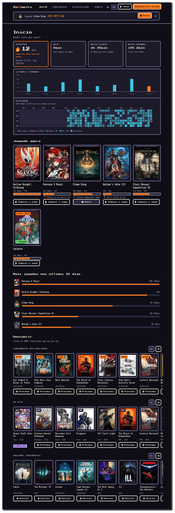
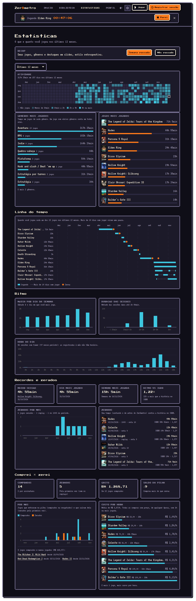
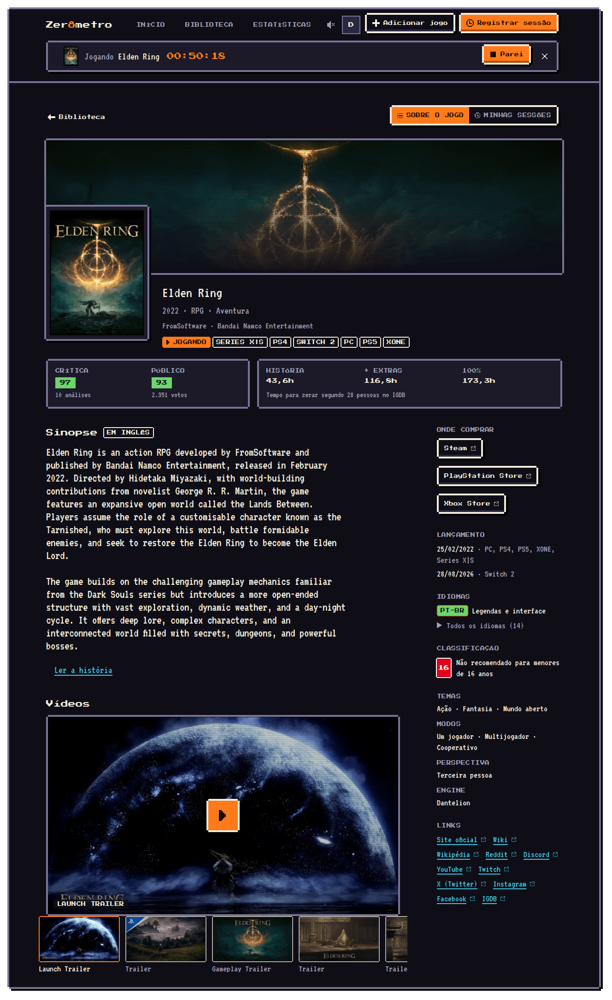
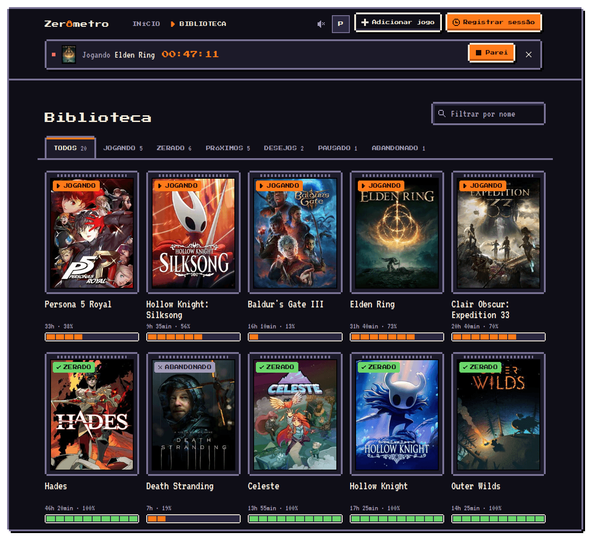
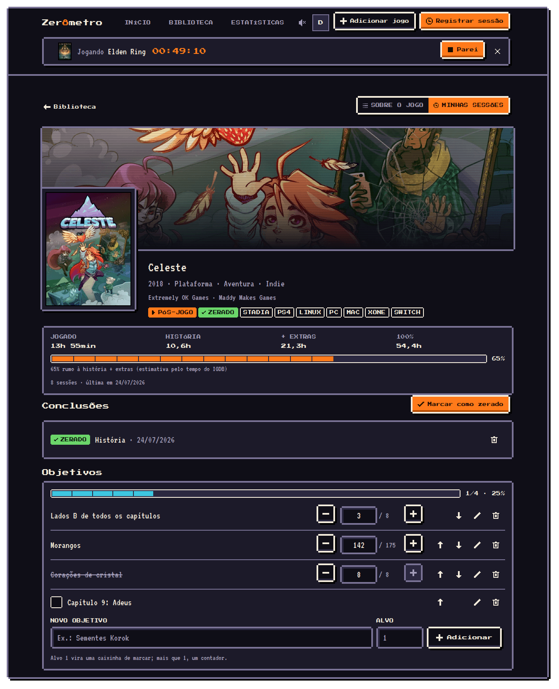
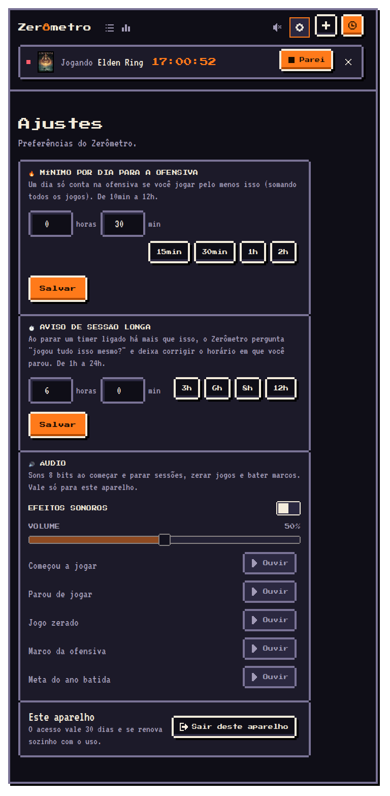

<p align="center">
  
</p>

<p align="center">
  
  
  
  
  
</p>

Tracker pessoal de jogos: backlog, tempo jogado por dia, ofensiva e estimativa de quanto falta para zerar cada jogo. Também dá para consultar tudo por IA através de um servidor **MCP** ("comecei a jogar", "joguei 2h ontem", "zerei").

> 🧪 **Self-hosted: cada pessoa hospeda o seu.** Uma instância do Zerômetro é de uma pessoa só e fica protegida por um token de acesso (`ZEROMETRO_TOKEN`, no `.env`). Não existe um serviço público: suba a sua (veja [Rodando localmente](#-rodando-localmente) e [Deploy](#-deploy-railway)). Todas as instâncias buildam deste repositório, então cada push na `main` chega a todo mundo.

> 🚧 **Em desenvolvimento.** A seção abaixo separa o que já funciona do que ainda falta.

---

## 📸 Telas

<p align="center">
  
  <br>
  <sub><b>Início</b> · ofensiva, médias, as últimas 8 semanas, o heatmap do ano, o que está jogando agora (com o timer rodando no topo), os mais jogados do mês e, no fim, o que descobrir no IGDB</sub>
</p>

<p align="center">
  
  <br>
  <sub><b>Estatísticas</b> · últimos 12 meses ou um ano: heatmap, gêneros e jogos mais jogados, ritmo (dia da semana, hora do dia, duração das sessões), recordes e zerados contra o tempo do IGDB</sub>
</p>

<p align="center">
  
  <br>
  <sub><b>Sobre o jogo</b> · a página de qualquer jogo do IGDB, na biblioteca ou não: notas, tempos para zerar, sinopse, trailer, imagens, onde comprar, se tem PT-BR, classificação indicativa e jogos relacionados</sub>
</p>

<table>
  <tr>
    <td width="50%" valign="top">
      
      <br><sub><b>Biblioteca</b> · cartuchos por status, com o progresso estimado como barra de XP</sub>
    </td>
    <td width="50%" valign="top">
      
      <br><sub><b>Minhas sessões</b> · a outra aba da página do jogo: tempo jogado contra os tempos do IGDB, conclusões (aqui em pós-jogo, rumo aos extras) e objetivos</sub>
    </td>
  </tr>
  <tr>
    <td width="50%" valign="top">
      
      <br><sub><b>Registrar sessão</b> · "joguei 1h30 ontem", com atalhos de duração e de dia</sub>
    </td>
    <td width="50%" valign="top">
      
      <br><sub><b>Adicionar jogo</b> · busca no IGDB, já indicando o que está na biblioteca</sub>
    </td>
  </tr>
  <tr>
    <td width="50%" valign="top">
      
      <br><sub><b>No celular</b> · o mesmo app, pensado para registrar do sofá</sub>
    </td>
    <td width="50%" valign="top">
      
      <br><sub><b>Login</b> · token de acesso da instância, vale 30 dias por aparelho</sub>
      <br><br>
      
      <br><sub><b>Ajustes</b> · mínimo da ofensiva, aviso de sessão longa e sons 8 bits</sub>
    </td>
  </tr>
</table>

<sub>Prints com os dados de exemplo de <code>mise run demo</code>. Capas e tempos para zerar: IGDB.</sub>

---

## ✨ Funcionalidades

### Já funciona

- **Acesso por token:** cada instância é de uma pessoa; entra quem tem o `ZEROMETRO_TOKEN`, e o login vale 30 dias por aparelho (renovado com o uso)
- **Biblioteca por status:** jogando, zerados, próximos, lista de desejos, pausados e abandonados
- **Dados do IGDB:** busca de jogos com capa, plataformas, gêneros, ano e tempo para zerar
- **Registro de sessões:** manual ("joguei 2h ontem") ou pelo **timer** ("Comecei a jogar" / "Parei"), que roda no servidor e não se perde ao fechar a aba
- **Estatísticas:** 🔥 ofensiva atual e recorde (com mínimo diário configurável), hoje, média diária e semanal, gráfico das últimas 8 semanas e heatmap dos últimos 12 meses na tela inicial
- **Página de estatísticas** (últimos 12 meses ou um ano): heatmap estilo GitHub, gêneros e jogos mais jogados, média por dia da semana, hora do dia (sessões de timer), duração das sessões, recordes (maior sessão, melhor dia e semana), zerados por mês (com replays e 100% à parte) e seu ritmo comparado ao tempo da história no IGDB
- **Página de cada jogo**, na biblioteca ou não, com duas abas: **Sobre o jogo** (banner, notas da crítica e do público, tempos para zerar, sinopse, trailer, imagens, onde comprar, lançamento por plataforma, português do Brasil, classificação indicativa e jogos relacionados para ir de jogo em jogo) e **Minhas sessões** (tempo jogado, progresso, conclusões, objetivos, sessões e detalhes)
- **Descobrir na tela inicial:** listas do IGDB com os lançamentos bem avaliados, os jogos em alta e os próximos lançamentos, atualizadas uma vez por dia, com botão de adicionar (próximos ou desejos) e o status dos que já estão na biblioteca
- **Tempo para zerar:** história, história + extras e 100%, com o progresso estimado de cada jogo
- **Conclusões e pós-jogo:** "zerei" é separado do status. Registre a história, a história + extras ou o 100% (com data, inclusive replays); um jogo zerado que você continua jogando fica em "Jogando" com o selo de zerado e o rótulo **Pós-jogo** (com filtro na biblioteca), e a barra de progresso passa a mirar o próximo nível
- **Objetivos por jogo:** caixinhas ou contadores ("900 sementes Korok") com barra geral; concluir o último sugere marcar o jogo como 100%
- **Tempo jogado antes do Zerômetro:** para jogos que você já vinha jogando ("tenho 39h de Witcher 3"), sem inventar sessões; conta no total e no progresso do jogo, mas não na ofensiva nem nas médias
- **Instalável como app** (PWA) no computador (Chrome, Edge, Safari) e no celular, com janela própria, atalhos no ícone e um aviso com o passo a passo de cada navegador
- **Funciona sem internet:** o app abre offline com os dados já vistos neste aparelho (só leitura), e registrar sessão, "Comecei", "Parei" e trocar de jogo vão para uma fila no aparelho com o horário real. Quando a conexão volta, a fila é enviada em ordem e sem duplicar (mesmo com várias abas); o cabeçalho mostra o que está pendente e, se o servidor recusar algo (ex.: o timer já tinha começado em outro aparelho), o motivo, com a opção de descartar
- **Efeitos sonoros 8 bits** (desligados por padrão): ao começar e parar sessões, zerar jogos e bater marcos da ofensiva, com volume nos ajustes
- **Servidor MCP** em `/mcp` com OAuth próprio, aprovado com o token (conector do claude.ai, Claude Code), com tools de leitura e de escrita (timer, sessões, adicionar jogo, status, conclusões e objetivos)
- **Deploy na Railway** como código (`.railway/railway.ts`) + imagem Docker

### Ainda falta

- [x] ~**Tools de edição e remoção no MCP** (editar/apagar sessão, editar/remover jogo, com confirmação)~
- [x] ~Tela inicial com listas do IGDB: lançamentos bem avaliados, em alta e próximos lançamentos~
- [x] ~Página própria para jogos do IGDB, inclusive os que ainda não estão na biblioteca~
- [x] ~Heatmap anual estilo GitHub e gráficos com Recharts~
- [ ] Kanban da biblioteca com arrastar e soltar (o hook já existe: `useMoveGameStatus`)
- [ ] Metas anuais (ex.: zerar 20 jogos no ano) e o som de "meta batida"
- [ ] Previsão do backlog ("no seu ritmo, você termina a fila em março")
- [ ] Recomendações a partir dos jogos que você zerou e gostou
- [ ] Histórico de atividade na interface (o que foi mudado pelo site e pela IA)
- [ ] Backup do SQLite (Litestream para um bucket S3/R2)
- [x] ~PWA (instalar no computador e no celular)~
- [x] ~Registrar sessões offline e sincronizar quando a conexão voltar~
- [ ] Retrospectiva do ano
- [ ] Alertas de lançamento da lista de desejos
- [ ] Sincronização de tempo jogado da Steam
- [ ] Conquistas da Steam e do RetroAchievements nos objetivos (a tabela já aceita a fonte)

---

## 🧱 Stack

| Camada                          | Tecnologia                                                                  |
| ------------------------------- | --------------------------------------------------------------------------- |
| Runtime                         | [Bun](https://bun.sh)                                                       |
| API                             | [Hono](https://hono.dev)                                                    |
| Banco                           | SQLite (`bun:sqlite`) + [Drizzle ORM](https://orm.drizzle.team)             |
| Frontend                        | React + TypeScript                                                          |
| Rotas / dados / forms / tabelas | [TanStack](https://tanstack.com) Router, Query, Form e Table                |
| UI                              | [shadcn/ui](https://ui.shadcn.com) + Tailwind CSS                           |
| Estado de UI                    | Zustand                                                                     |
| Validação                       | Zod (compartilhado entre API, frontend e MCP)                               |
| Acesso                          | Token da instância + cookie assinado; OAuth 2.1 próprio para o MCP          |
| IA                              | [Model Context Protocol](https://modelcontextprotocol.io) (Streamable HTTP) |
| Dados de jogos                  | [IGDB API](https://api-docs.igdb.com)                                       |

Um único processo Bun serve a API, o servidor MCP e o frontend.

```
src/
  server/
    routes/    # REST (/api/*) consumido pelo frontend
    mcp/       # servidor MCP (/mcp) e as tools
    oauth/     # servidor OAuth do MCP (registro, autorização com o token, tokens)
    services/  # regras de negócio, usadas por REST e MCP
    db/        # schema e migrations
  web/         # SPA React
  shared/      # schemas Zod e tipos compartilhados
```

---

## 🚀 Rodando localmente

### Pré-requisitos

- [mise](https://mise.jdx.dev): instala as versões certas do Bun, Node, oxlint e oxfmt e centraliza variáveis de ambiente e tarefas no `mise.toml`
- Credenciais do IGDB: crie um app no [Twitch Developer Console](https://dev.twitch.tv/console/apps) para obter `client_id` e `client_secret`

### Passos

```bash
git clone https://github.com/ArthurResendeC/Zerometro.git zerometro
cd zerometro
mise trust && mise install   # Bun e Node nas versões do mise.toml
mise run install             # dependências
cp .env.example .env         # preencha as credenciais do IGDB
mise run token >> .env       # gera o seu ZEROMETRO_TOKEN (é com ele que você entra)
mise run db:migrate
mise run dev                 # http://localhost:3000
```

Outras tarefas (`mise tasks` lista todas):

| Tarefa                               | O que faz                                      |
| ------------------------------------ | ---------------------------------------------- |
| `mise run check`                     | formatação + lint + typecheck + testes         |
| `mise run token`                     | gera um token de acesso novo                   |
| `mise run fmt` / `mise run lint:fix` | formata (oxfmt) e corrige lint (oxlint)        |
| `mise run build` / `mise run start`  | build de produção em `dist/` e execução        |
| `mise run db:generate`               | gera migration a partir do schema              |
| `mise run db:studio`                 | abre o Drizzle Studio                          |
| `mise run mcp:inspect`               | abre o MCP Inspector                           |
| `mise run igdb:smoke [termo]`        | testa busca e tempo para zerar no IGDB real    |
| `mise run demo`                      | sobe com dados de exemplo em `data/demo.db`    |
| `mise run demo:capture`              | congela as páginas de jogo do demo (IGDB real) |
| `mise run icons`                     | gera os ícones PNG do app (PWA e iOS)          |

### Variáveis de ambiente

Os padrões ficam no `[env]` do `mise.toml`; valores locais e segredos vão no `.env` (carregado pelo mise, não versionado).

| Variável                                | Descrição                                                                                  |
| --------------------------------------- | ------------------------------------------------------------------------------------------ |
| `IGDB_CLIENT_ID` / `IGDB_CLIENT_SECRET` | Credenciais do app na Twitch                                                               |
| `ZEROMETRO_TOKEN`                       | Token de acesso da instância (pelo menos 32 caracteres; `mise run token`). Obrigatório     |
| `PUBLIC_URL`                            | URL pública do site (padrão: domínio da Railway ou `http://localhost:$PORT`)               |
| `DATABASE_PATH`                         | Caminho do arquivo SQLite (padrão: `data/zerometro.db` na raiz do projeto)                 |
| `PORT`                                  | Porta do servidor (padrão: `3000`)                                                         |
| `TZ`                                    | Fuso usado nas estatísticas (padrão: `America/Sao_Paulo`)                                  |
| `ZEROMETRO_DOMAIN`                      | Só no deploy: domínio próprio da sua instância na Railway (ver [Deploy](#-deploy-railway)) |
| `ZEROMETRO_VOLUME_REGION`               | Só no deploy: região do volume do SQLite (padrão: `us-west2`)                              |

---

## 🤖 Usando com IA (MCP)

O Zerômetro expõe um servidor MCP em `/mcp` (Streamable HTTP), com dois jeitos de autenticar:

- **OAuth 2.1** (para o claude.ai, que só conecta assim): o conector se registra sozinho, abre a página `/authorize` da sua instância e você aprova digitando o `ZEROMETRO_TOKEN`. O conector recebe tokens próprios (1h, renovados sozinhos por até 30 dias de inatividade); o seu token nunca sai do seu navegador.
- **O próprio token como Bearer**, para clientes configurados à mão.

**Conectar no claude.ai:** Configurações → Conectores → Adicionar conector personalizado → URL `https://<seu-domínio>/mcp` → Conectar → digite o token. O site precisa estar acessível pela internet (o claude.ai conecta a partir dos servidores da Anthropic).

**Claude Code** (OAuth, abre o navegador para aprovar):

```bash
claude mcp add --transport http zerometro https://<seu-domínio>/mcp
```

Ou com o token direto, sem passar pelo navegador:

```bash
claude mcp add --transport http zerometro https://<seu-domínio>/mcp \
  --header "Authorization: Bearer $ZEROMETRO_TOKEN"
```

Por segurança, o OAuth só devolve a pessoa para o claude.ai e para endereços locais (`localhost`, usado pelo Claude Code e pelo MCP Inspector). Trocar o `ZEROMETRO_TOKEN` desconecta todos os conectores.

**Tools disponíveis (leitura):** `search_igdb`, `get_feeds` (as listas da tela inicial: bem avaliados, em alta e próximos), `list_library` (com filtro de pós-jogo), `get_game` (com conclusões e objetivos), `list_objectives`, `get_stats`, `get_period_stats` (um ano ou os últimos 12 meses: gêneros, horários, recordes e zerados), `list_sessions`, `get_active_session`. O jogo pode ser passado pelo id ou pelo nome (sem diferenciar acentos); se o nome for ambíguo, a tool devolve as opções.

**Tools de escrita:** `start_session` / `stop_session` (o mesmo timer do site), `log_session` (sessão já jogada, ex.: "joguei 2h ontem"), `add_game` (pelo igdbId achado com `search_igdb`, opcionalmente com o tempo já jogado), `set_status`, `set_prior_playtime` (tempo jogado antes do Zerômetro, ex.: "já tenho 39h de Witcher 3"), `mark_completed` ("zerei o Ocarina mas vou continuar jogando", "platinei"), `add_objective` ("adiciona o objetivo 900 sementes Korok no BotW") e `update_objective` ("peguei mais 10 sementes"). As que apagam (`remove_completion`, `delete_objective`) só executam com `confirm: true`; sem isso, mostram o que seria apagado. Tudo fica no histórico de atividade com actor `mcp`.

**Planejadas:** `update_session`, `update_game_entry`, `remove_game`, `delete_session`. As destrutivas só vão executar com confirmação explícita.

Para inspecionar localmente: `mise run mcp:inspect` e aponte para `http://localhost:3000/mcp`.

---

## 🙏 Créditos

- Dados de jogos e tempos para zerar fornecidos pelo [IGDB](https://www.igdb.com)
- O servidor OAuth do MCP (`src/server/oauth/`) foi adaptado do [my-scratchpad](https://github.com/Levieber/my-scratchpad) (MIT)
- Projeto pessoal, sem afiliação com IGDB, Twitch ou qualquer publisher

---

## 📄 Licença

[MIT](./LICENSE)

---

## 🚀 Deploy (Railway)

Cada pessoa sobe **a sua** instância, no próprio projeto da Railway e com os próprios segredos, mas todas buildam do mesmo repositório: um push na `main` daqui chega a todo mundo. A infraestrutura está em [`.railway/railway.ts`](.railway/railway.ts) ([IaC da Railway](https://docs.railway.com/infrastructure-as-code)): um serviço `web` buildado pelo [`Dockerfile`](Dockerfile) a partir da `main` no GitHub, com um volume em `/data` para o SQLite (uma réplica só). As migrations rodam no boot do servidor, porque o volume não fica montado no build nem no pre-deploy.

O que muda de uma instância para outra **não fica no código**: o `railway.ts` lê do ambiente de quem roda o plan/apply (o mise carrega o seu `.env`):

| Variável                  | Para quê                                                                                                         |
| ------------------------- | ---------------------------------------------------------------------------------------------------------------- |
| `ZEROMETRO_DOMAIN`        | Domínio próprio (ex.: `zerometro.exemplo.com`). Opcional: sem ele, a instância usa o domínio gerado pela Railway |
| `ZEROMETRO_VOLUME_REGION` | Região do volume (padrão: `us-west2`). Só mude se o seu volume já existe em outra região                         |
| `TZ`                      | Fuso da instância (padrão do `mise.toml`: `America/Sao_Paulo`)                                                   |

Testar a imagem localmente (precisa do Docker):

```sh
mise run docker:run   # builda e sobe em http://localhost:3000 com os segredos do .env
```

Primeiro deploy (precisa de acesso de colaborador ao repositório e do [app da Railway no GitHub](https://docs.railway.com/guides/github-autodeploys) com acesso a ele):

```sh
railway login
railway init --name zerometro      # cria o SEU projeto e vincula esta pasta (ou: railway link)

# (opcional) domínio próprio: no .env
echo 'ZEROMETRO_DOMAIN=zerometro.exemplo.com' >> .env

mise run deploy:plan               # confere o que vai ser criado
mise run deploy:apply              # cria o serviço, o volume e o domínio próprio

# Segredos (uma vez; o railway.ts usa preserve() e nunca guarda valores).
# O token de produção é o que você vai digitar para entrar: guarde num gerenciador de senhas.
railway variable set --service web "$(mise run -q token)" --skip-deploys
railway variable set --service web IGDB_CLIENT_ID=... IGDB_CLIENT_SECRET=... --skip-deploys

# Sem domínio próprio: gera https://<nome>.up.railway.app
railway domain --service web
```

Com domínio próprio, crie no seu DNS o registro que a Railway mostra em _Settings → Networking_ do serviço. O deploy que o `apply` dispara falha até os segredos existirem (sem `ZEROMETRO_TOKEN` o servidor nem sobe, e não mexe no banco); depois deles, `railway redeploy --service web`. Daí em diante, cada push na `main` faz um deploy novo.

**Ver ou trocar o token:** `railway variable list --service web` mostra o atual. Para trocar (ex.: vazou), rode `railway variable set --service web "$(mise run -q token)"`: o deploy novo desloga todos os aparelhos e desconecta todos os conectores MCP, e você entra de novo com o token novo.

Mudanças de infraestrutura: edite `.railway/railway.ts`, rode `mise run deploy:plan` e depois `mise run deploy:apply`. Rode sempre com o **seu** `.env`: sem `ZEROMETRO_DOMAIN`, o plan apaga a `PUBLIC_URL` da instância.
