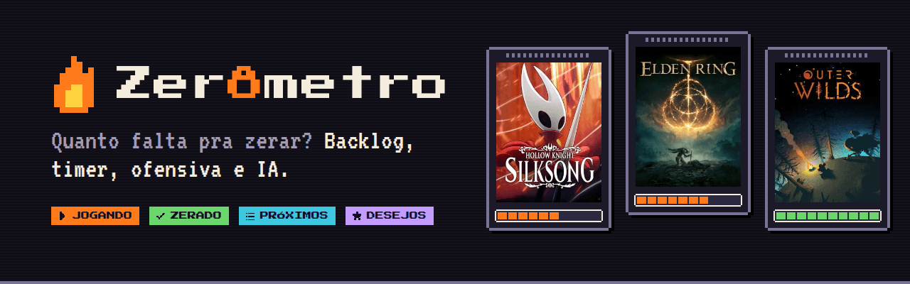
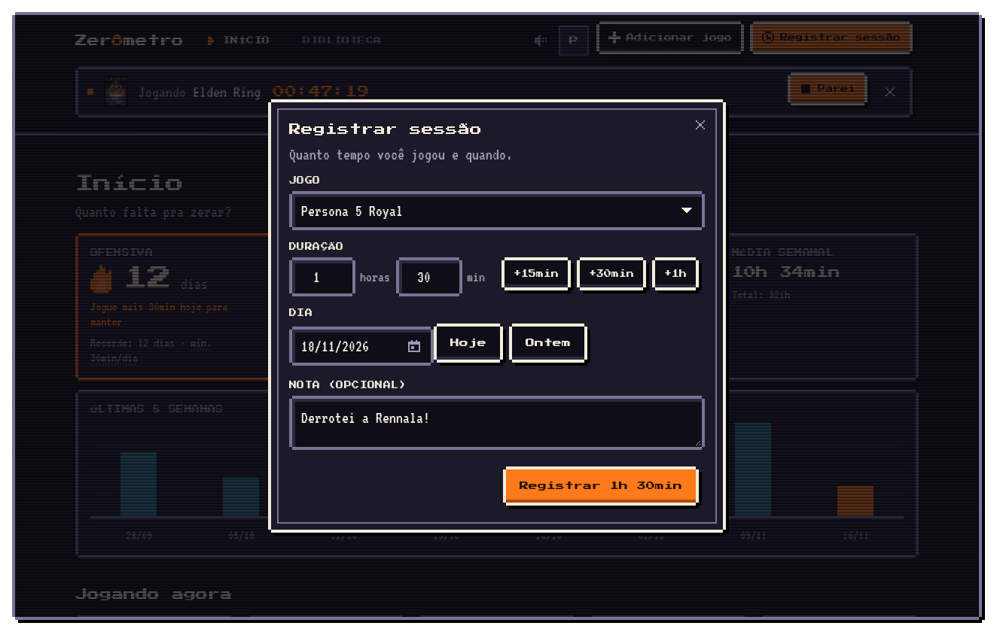
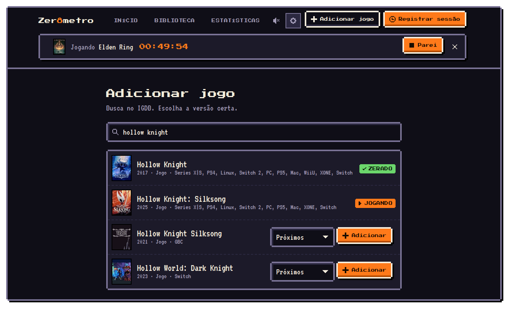
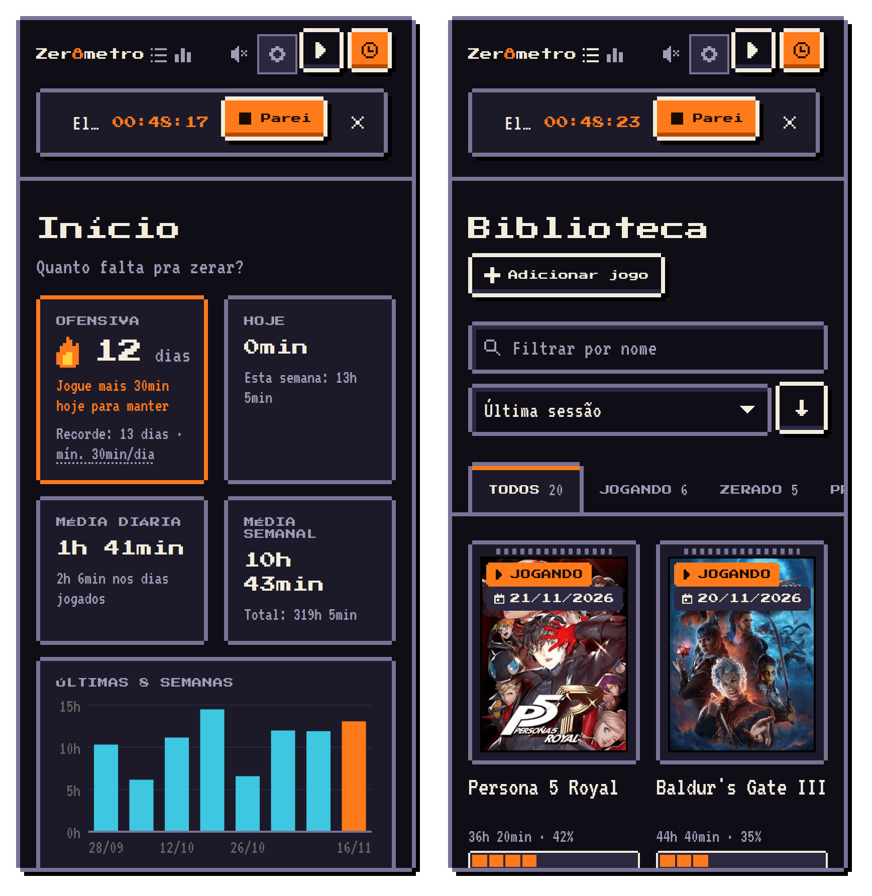
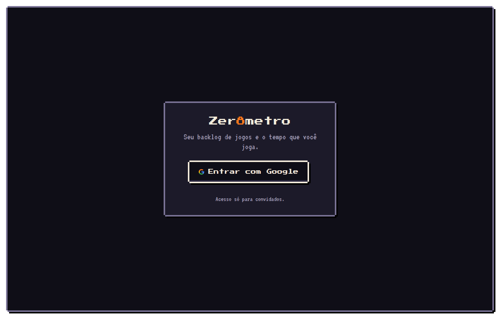

<p align="center">
  
</p>

<p align="center">
  
  
  
  
  
</p>

Tracker pessoal de jogos: backlog, tempo jogado por dia, ofensiva e estimativa de quanto falta para zerar cada jogo. Também dá para consultar tudo por IA através de um servidor **MCP** ("comecei a jogar", "joguei 2h ontem", "zerei").

> 🧪 **Projeto de exemplo, feito para cada um hospedar o seu.** O Zerômetro é um projeto pessoal publicado como referência. A minha instância é privada: só entram os e-mails convidados (`ALLOWED_EMAILS`), então ela não serve como serviço público. Para usar, faça um fork e suba a sua (veja [Rodando localmente](#-rodando-localmente) e [Deploy](#-deploy-railway)).

> 🚧 **Em desenvolvimento.** A seção abaixo separa o que já funciona do que ainda falta.

---

## 📸 Telas

<p align="center">
  
  <br>
  <sub><b>Início</b> · ofensiva, médias, as últimas 8 semanas, o que está jogando agora (com o timer rodando no topo) e os mais jogados do mês</sub>
</p>

<table>
  <tr>
    <td width="50%" valign="top">
      
      <br><sub><b>Biblioteca</b> · cartuchos por status, com o progresso estimado como barra de XP</sub>
    </td>
    <td width="50%" valign="top">
      
      <br><sub><b>Jogo</b> · tempo jogado contra os tempos do IGDB e o histórico de sessões</sub>
    </td>
  </tr>
  <tr>
    <td width="50%" valign="top">
      
      <br><sub><b>Registrar sessão</b> · "joguei 1h30 ontem", com atalhos de duração e de dia</sub>
    </td>
    <td width="50%" valign="top">
      
      <br><sub><b>Adicionar jogo</b> · busca no IGDB, já indicando o que está na biblioteca</sub>
    </td>
  </tr>
  <tr>
    <td width="50%" valign="top">
      
      <br><sub><b>No celular</b> · o mesmo app, pensado para registrar do sofá</sub>
    </td>
    <td width="50%" valign="top">
      
      <br><sub><b>Login</b> · Google, só para convidados</sub>
      <br><br>
      
      <br><sub><b>Ajustes</b> · mínimo da ofensiva, aviso de sessão longa e sons 8 bits</sub>
    </td>
  </tr>
</table>

<sub>Prints com os dados de exemplo de <code>mise run demo</code>. Capas e tempos para zerar: IGDB.</sub>

---

## ✨ Funcionalidades

### Já funciona

- **Login com Google** (Better Auth) restrito a uma lista de convidados; cada pessoa só vê os próprios dados
- **Biblioteca por status:** jogando, zerados, próximos, lista de desejos, pausados e abandonados
- **Dados do IGDB:** busca de jogos com capa, plataformas, gêneros, ano e tempo para zerar
- **Registro de sessões:** manual ("joguei 2h ontem") ou pelo **timer** ("Comecei a jogar" / "Parei"), que roda no servidor e não se perde ao fechar a aba
- **Estatísticas:** 🔥 ofensiva atual e recorde (com mínimo diário configurável), hoje, média diária e semanal, gráfico das últimas 8 semanas e jogos mais jogados
- **Tempo para zerar:** história, história + extras e 100%, com o progresso estimado de cada jogo
- **Tempo jogado antes do Zerômetro:** para jogos que você já vinha jogando ("tenho 39h de Witcher 3"), sem inventar sessões; conta no total e no progresso do jogo, mas não na ofensiva nem nas médias
- **Efeitos sonoros 8 bits** (desligados por padrão): ao começar e parar sessões, zerar jogos e bater marcos da ofensiva, com volume nos ajustes
- **Servidor MCP** em `/mcp` com login OAuth (conector do claude.ai, Claude Code), com tools de leitura e de escrita (timer, sessões, adicionar jogo, status)
- **Deploy na Railway** como código (`.railway/railway.ts`) + imagem Docker

### Ainda falta

- [x] ~**Tools de edição e remoção no MCP** (editar/apagar sessão, editar/remover jogo, com confirmação)~
- [ ] Tela inicial com listas do IGDB: lançamentos bem avaliados, em alta e próximos lançamentos
- [ ] Heatmap anual estilo GitHub e gráficos com Recharts
- [ ] Kanban da biblioteca com arrastar e soltar (o hook já existe: `useMoveGameStatus`)
- [ ] Metas anuais (ex.: zerar 20 jogos no ano) e o som de "meta batida"
- [ ] Previsão do backlog ("no seu ritmo, você termina a fila em março")
- [ ] Recomendações a partir dos jogos que você zerou e gostou
- [ ] Histórico de atividade na interface (o que foi mudado pelo site e pela IA)
- [ ] Backup do SQLite (Litestream para um bucket S3/R2)
- [ ] PWA
- [ ] Retrospectiva do ano
- [ ] Alertas de lançamento da lista de desejos
- [ ] Sincronização de tempo jogado da Steam

---

## 🧱 Stack

| Camada                          | Tecnologia                                                                  |
| ------------------------------- | --------------------------------------------------------------------------- |
| Runtime                         | [Bun](https://bun.sh)                                                       |
| API                             | [Hono](https://hono.dev)                                                    |
| Banco                           | SQLite (`bun:sqlite`) + [Drizzle ORM](https://orm.drizzle.team)             |
| Frontend                        | React + TypeScript                                                          |
| Rotas / dados / forms / tabelas | [TanStack](https://tanstack.com) Router, Query, Form e Table                |
| UI                              | [shadcn/ui](https://ui.shadcn.com) + Tailwind CSS                           |
| Estado de UI                    | Zustand                                                                     |
| Validação                       | Zod (compartilhado entre API, frontend e MCP)                               |
| IA                              | [Model Context Protocol](https://modelcontextprotocol.io) (Streamable HTTP) |
| Dados de jogos                  | [IGDB API](https://api-docs.igdb.com)                                       |

Um único processo Bun serve a API, o servidor MCP e o frontend.

```
src/
  server/
    routes/    # REST (/api/*) consumido pelo frontend
    mcp/       # servidor MCP (/mcp) e as tools
    services/  # regras de negócio, usadas por REST e MCP
    db/        # schema e migrations
  web/         # SPA React
  shared/      # schemas Zod e tipos compartilhados
```

---

## 🚀 Rodando localmente

### Pré-requisitos

- [mise](https://mise.jdx.dev): instala as versões certas do Bun, Node, oxlint e oxfmt e centraliza variáveis de ambiente e tarefas no `mise.toml`
- Credenciais do IGDB: crie um app no [Twitch Developer Console](https://dev.twitch.tv/console/apps) para obter `client_id` e `client_secret`
- Um cliente OAuth do Google, para o login: no [Google Cloud Console](https://console.cloud.google.com) → Google Auth Platform → Clients, crie um "Web application" com a origem `http://localhost:3000` e o redirect `http://localhost:3000/api/auth/callback/google`

### Passos

```bash
git clone https://github.com/<seu-usuario>/zerometro.git   # o seu fork
cd zerometro
mise trust && mise install   # Bun e Node nas versões do mise.toml
mise run install             # dependências
cp .env.example .env         # preencha as variáveis (inclusive o seu e-mail em ALLOWED_EMAILS)
mise run db:migrate
mise run dev                 # http://localhost:3000
```

Outras tarefas (`mise tasks` lista todas):

| Tarefa                               | O que faz                                   |
| ------------------------------------ | ------------------------------------------- |
| `mise run check`                     | formatação + lint + typecheck + testes      |
| `mise run fmt` / `mise run lint:fix` | formata (oxfmt) e corrige lint (oxlint)     |
| `mise run build` / `mise run start`  | build de produção em `dist/` e execução     |
| `mise run db:generate`               | gera migration a partir do schema           |
| `mise run db:studio`                 | abre o Drizzle Studio                       |
| `mise run mcp:inspect`               | abre o MCP Inspector                        |
| `mise run igdb:smoke [termo]`        | testa busca e tempo para zerar no IGDB real |
| `mise run demo`                      | sobe com dados de exemplo em `data/demo.db` |

### Variáveis de ambiente

Os padrões ficam no `[env]` do `mise.toml`; valores locais e segredos vão no `.env` (carregado pelo mise, não versionado).

| Variável                                    | Descrição                                                                             |
| ------------------------------------------- | ------------------------------------------------------------------------------------- |
| `IGDB_CLIENT_ID` / `IGDB_CLIENT_SECRET`     | Credenciais do app na Twitch                                                          |
| `BETTER_AUTH_SECRET`                        | Assina os cookies de sessão (`openssl rand -base64 32`); obrigatório em produção      |
| `BETTER_AUTH_URL`                           | URL pública do site (padrão: domínio da Railway ou `http://localhost:$PORT`)          |
| `GOOGLE_CLIENT_ID` / `GOOGLE_CLIENT_SECRET` | Cliente OAuth do Google para o login                                                  |
| `ALLOWED_EMAILS`                            | E-mails convidados, separados por vírgula; o primeiro é o dono. Vazio = ninguém entra |
| `DATABASE_PATH`                             | Caminho do arquivo SQLite (padrão: `data/zerometro.db` na raiz do projeto)            |
| `PORT`                                      | Porta do servidor (padrão: `3000`)                                                    |
| `TZ`                                        | Fuso usado nas estatísticas (padrão: `America/Sao_Paulo`)                             |

---

## 🤖 Usando com IA (MCP)

O Zerômetro expõe um servidor MCP em `/mcp` (Streamable HTTP). O login é OAuth 2.1 com registro dinâmico de clientes: o conector se registra sozinho, você entra com o Google (só convidados) e autoriza na tela `/autorizar`. As tools rodam com os dados de quem autorizou.

**Conectar no claude.ai:** Configurações → Conectores → Adicionar conector personalizado → URL `https://<seu-domínio>/mcp`. O site precisa estar acessível pela internet (o claude.ai conecta a partir dos servidores da Anthropic).

**Claude Code:**

```bash
claude mcp add --transport http zerometro https://<seu-domínio>/mcp
```

**Tools disponíveis (leitura):** `search_igdb`, `list_library`, `get_game`, `get_stats`, `list_sessions`, `get_active_session`. O jogo pode ser passado pelo id ou pelo nome (sem diferenciar acentos); se o nome for ambíguo, a tool devolve as opções.

**Tools de escrita:** `start_session` / `stop_session` (o mesmo timer do site), `log_session` (sessão já jogada, ex.: "joguei 2h ontem"), `add_game` (pelo igdbId achado com `search_igdb`, opcionalmente com o tempo já jogado), `set_status` e `set_prior_playtime` (tempo jogado antes do Zerômetro, ex.: "já tenho 39h de Witcher 3"). Tudo fica no histórico de atividade com actor `mcp`.

**Planejadas:** `update_session`, `update_game_entry`, `remove_game`, `delete_session`. As destrutivas só vão executar com confirmação explícita.

Para inspecionar localmente: `mise run mcp:inspect` e aponte para `http://localhost:3000/mcp`.

---

## 🙏 Créditos

- Dados de jogos e tempos para zerar fornecidos pelo [IGDB](https://www.igdb.com)
- Projeto pessoal, sem afiliação com IGDB, Twitch ou qualquer publisher

---

## 📄 Licença

[MIT](./LICENSE)

---

## 🚀 Deploy (Railway)

Estes passos sobem **a sua** instância, no seu projeto da Railway e com os seus segredos. A infraestrutura está em [`.railway/railway.ts`](.railway/railway.ts) ([IaC da Railway](https://docs.railway.com/infrastructure-as-code)): um serviço `web` buildado pelo [`Dockerfile`](Dockerfile) a partir da `main` no GitHub, com um volume em `/data` para o SQLite (uma réplica só). As migrations rodam no boot do servidor, porque o volume não fica montado no build nem no pre-deploy.

Testar a imagem localmente (precisa do Docker):

```sh
mise run docker:run   # builda e sobe em http://localhost:3000 com os segredos do .env
```

Primeiro deploy:

```sh
railway init --name zerometro      # cria o projeto e vincula esta pasta (ou: railway link)
mise run deploy:plan               # confere o que vai ser criado
mise run deploy:apply              # cria o serviço e o volume

# Segredos (uma vez; o railway.ts usa preserve() e nunca guarda valores)
railway variable set --service web BETTER_AUTH_SECRET="$(openssl rand -base64 32)" --skip-deploys
railway variable set --service web GOOGLE_CLIENT_ID=... GOOGLE_CLIENT_SECRET=... --skip-deploys
railway variable set --service web IGDB_CLIENT_ID=... IGDB_CLIENT_SECRET=... --skip-deploys
railway variable set --service web ALLOWED_EMAILS=voce@gmail.com,amigo@gmail.com --skip-deploys

railway domain --service web       # gera https://<nome>.up.railway.app
```

No Google Cloud Console, acrescente a origem `https://<domínio>` e o redirect `https://<domínio>/api/auth/callback/google`. Depois é só `git push` (ou `railway redeploy --service web`). A URL pública vem de `RAILWAY_PUBLIC_DOMAIN`; com domínio próprio, defina `BETTER_AUTH_URL`.

Mudanças de infraestrutura: edite `.railway/railway.ts`, rode `mise run deploy:plan` e depois `mise run deploy:apply`.
